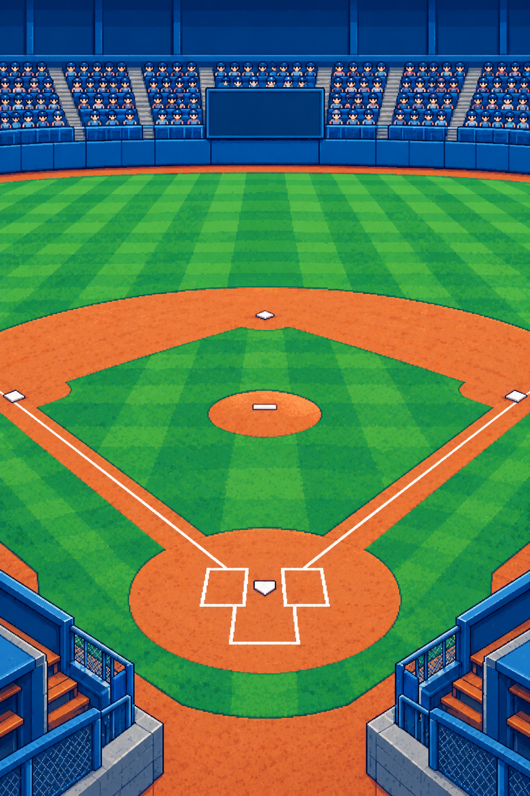

<div align="center">

# BM · Baseball Career

**고교에서 시작하는 나만의 야구 선수 커리어**

타자와 투수, 훈련과 실전, 성장과 계약을 연결하는 iOS 도트 야구 게임입니다.


[게임 소개](#overview) · [구현 현황](#features) · [실행 방법](#getting-started) · [검증 기록](#verification) · [개발 문서](#documents)



<sub>프로젝트의 실제 구장 배경 리소스입니다. 선수·공·전광판은 경기 중 별도 레이어로 표시합니다.</sub>

</div>

> **2026.10.27 이닝별 전광판 V27** · 새 공식 경기부터 1~9회 득점을 저장해 실제 R/H/E 옆에 표시합니다. 진행 이닝의 0, 공격 전 ·, 홈 승리로 생략한 9회 말 X, 과거 미기록 —를 구분합니다. 포구·수비/주루가 끝난 표시 스냅샷과 기존 저장·이어하기·결과 1회를 유지합니다. [구현·검증 이력](docs/implementation-history.md)

> **2026.10.27 구종 구성·학습 V26** · 새 투수는 9종 중 3~5개를 선택하고, 구종 보관함에서 5회 습득 훈련의 진척을 확인합니다. 진척 100에 새 구종을 숙련 20으로 등록하며 교체한 구종의 숙련은 보관하고 재등록 훈련으로 복원합니다. 기존 구종·숙련, 하루 행동·피로·이어하기와 보상 1회를 유지합니다. [구현·검증 이력](docs/implementation-history.md)

> **2026.10.27 투수 코스 선택 V25** · 포수 추천을 기본으로 탭·드래그해 목표를 변경하고 추천으로 복귀할 수 있습니다. 추천·목표·실제 도착을 서로 다른 표식으로 보여주며, 최근 공의 목표와 실제 좌표는 기존 경기 저장·재진입 경로로 복원합니다. 과거 목표 미기록·자동 투구와 결과 1회 반영을 유지합니다. [구현·검증 이력](docs/implementation-history.md)

> **2026.10.27 구속별 비행·낙차 V24** · 145km/h 기준 릴리스→포구 0.90초의 게임용 비행 시간을 타자·투수에 공통 적용했습니다. 구종별 후반 낙차와 좌투 반전을 보완하고 포구·정타 중앙 동기화를 유지합니다. 구속 수치·판정식·저장/이어하기/결과 1회는 유지하며, 실제 시간 기준 타격 허용 폭은 비행 단축에 비례해 줄어듭니다. [구현·검증 이력](docs/implementation-history.md)

> **2026.10.27 타자 타이밍 V23** · 공 비행·게이지·포구를 같은 시간 기준으로 연결했습니다. 동작 줄이기에서 공이 먼저 도착하던 문제를 수정하고 기존 구속 계산식·정타 중심·저장/이어하기/결과 1회 반영을 유지합니다. [구현·검증 이력](docs/implementation-history.md)

> **2026.10.26 경기 화면 V21·V22** · 경기장을 가로폭 전체로 넓히고 도트 전광판에 실제 경기 정보를 모았습니다. 타자는 상대 스와이프 조준·탭 타격, 투수는 선수 옆 구종·숙련도 선택을 사용합니다. 타격 타이밍의 빠름·정타·늦음 색과 소형 도트 구종 버튼을 보완했습니다. 기존 판정·저장·이어하기·결과 1회 반영을 유지합니다. [구현·검증 이력](docs/implementation-history.md)

> **2026.10.26 상세 화면 V20** · 특성 3슬롯·포지션 지도, 훈련 준비/5회 결과, 제의 조건·권리 비교, 프로젝트·시즌 목표, 최근 경기·개인 성적을 각 기능에 맞게 정리했습니다. 공간 V18과 V19 상세, 기존 저장·고정 보고서·이어하기·결과 1회 반영을 유지합니다. [구현·검증 이력](docs/implementation-history.md)


> **2026.10.26 공간형 관리 화면 반영** · 홈·선수·훈련·경기·커리어·휴식을 전체 방 배경과 시설 진입으로 정리했습니다. 하단 주 행동·5메뉴,실제 상태 표기,상세 시트와 기존 훈련/경기 경로를 연결했습니다. 단위7/UI6/보안9개 및 일반 Release 빌드를 확인했으며 물리 iPhone 인수와 장시간 성능 QA는 별도입니다. [구현·검증 이력](docs/implementation-history.md)


---

<a id="overview"></a>
## 어떤 게임인가요?

**16세 고교 선수로 시작해, 직접 경기를 뛰며 성장하는 개인 커리어 게임**을 만들고 있습니다. 능력치와 구종을 훈련하고, 경기 성적을 쌓으며, 스카우트의 관심과 국내 진로·계약 제의로 이어집니다.

**하루의 흐름**

선수 생성 → 훈련·휴식 → 공식 경기 → 성장·기록 → 다음 일정

경기 성적은 스카우트 관찰과 계약 평가로 이어집니다.

| 항목 | 현재 기준 |
|---|---|
| 플랫폼 | iPhone · 세로 화면 · iOS 17 이상 |
| 조작 | 타자 스와이프 조준·탭 타격 / 투수 옆 구종·숙련도 선택·릴리스 게이지 |
| 표현 | SwiftUI 정보 화면 + SpriteKit 도트 경기 연출 |
| 저장 | SwiftData 로컬 저장 · 서버·로그인·CloudKit 없음 |
| 개발 상태 | 기능을 구현하고 검증하는 개발 중 프로젝트 |

> 이 저장소는 **iOS 네이티브 프로젝트**입니다. 별도 웹 프로토타입과 전체 기획은 이 저장소의 배포물에 포함하지 않습니다.

<a id="features"></a>
## 지금 플레이할 수 있는 기능

| 영역 | 구현한 내용 |
|---|---|
| **선수 생성·홈** | 고교 50곳 선택·무작위 배정, 타자·투수 선택, 이름·등번호·외형·포지션·투구 손 설정, 유형·사용자 지정 능력치 배분 |
| **훈련·성장** | 능력별 미니게임, 구종 숙련도, 특성 습득·활성 관리, 포지션 훈련·실전 XP, 피로·휴식·하루 행동 제한 |
| **직접 경기** | 시작 시 고정하는 상대 투수 구종·구속·제구와 타선 능력, 타격 포인트·타이밍, 지켜보기·스윙·번트, 구종 선택·릴리스, 볼카운트·타석·주자 진행 |
| **수비·주루** | 능력치·타구 코스·도착 시간 판정, 병살·태그업·중계·실책, 슬라이딩·태그·베이스 포구, 홈런 비행·베이스 일주 |
| **일정·시즌** | 가상 6팀·팀당 연 30경기, 투수 선발 로테이션, 비경기일 묶음 진행, 순위·시즌 성적·결산·오프시즌 |
| **기록·이어하기** | 경기 원장, 중단 후 이어하기, 결과·XP 1회 반영, 최근 5경기와 시즌 누적 성적 |
| **스카우트·진로** | 28일 고정 보고서, 구단 관심·모집 역할·적합도, 고교·19세 준비·20세 진로와 소속 이력, 목표 구단·역할 저장과 현재 기량/표본·고정 관찰 기준/자격 준비 현황, 28일 훈련·공식 출전 프로젝트와 다음 보고서 진척 고정, 상대 NPC 분석·경기 전 계획/수행 결과의 다음 보고서 연결, 목표 부족 능력 특별 훈련·자동2경기 진단과 다음 보고서 근거 고정, 28일 관찰 결산·이전 보고서 대비 변화/부족 조건·추천 행동, 모집 역할/부족 조건별 고정 과제·실전 지표/포지션 훈련 진척, 선택형 타격·투구 평가전/공 단위 이어하기·역할별 기록 진단 |
| **국내 선발·계약** | 평가 창과 재평가 방지, 국내 신인·대학 선발·제의 비교·수락/거절·소속 발효, 국내 육성팀 11월 재계약·수락/거절·기간 갱신, 별도 방출/권리 해제·무소속 재입단·인증 자동 평가전, 대학 재학생 프로 심사·제의/예약 수락·다음 시즌 육성팀 전환 |
| **해외 선발·계약** | 자격·권리/경력 원장, 성인 환경별 비교·2년 전망, 해외 모집·관심, MLB 조직 육성·NPB/MLB 전력 제의·수락/거절·다음 시즌 소속/경기, 국내1군·미국 내부 메이저 승격, 해외 계약/소속/권리 분리·11월 재계약/다음 개막 기간 갱신·별도 해외 방출/무소속 인증·국내 재입단, 단축 시즌 FA 경력·선언/발효·해외 전력 재취업, 국내·해외 공통 계약 시장의 잔류/외부 조건 비교·마감/제의 없음·재도전 창구 |

해외 경로는 가상 구단·30경기 단축 리그의 **게임 정책**입니다. 지원 등록·승인·게임 경력을 실제 국제계약/포스팅/FA 자격 인증으로 취급하지 않습니다.

### 아직 남아 있는 범위

구현한 기능과 출시 인수를 구분합니다. 아래 항목은 위 표의 완료 범위에 포함하지 않습니다.

- **계약 확장:** 협상·전체 리그 시장 수급·실제 서비스 일수/FA 재취득·보상/예외, 세부 등록·권리/실제 국제정책, 전체 리그 시장 수급과 직접 조작 인증 경기.
- **야구 규칙 확장:** 공식 팀 자책점·투수 승패, 추가 투수 교체·정식 불펜, 복합 수비 상황.
- **제품 인수:** 다른 기종·iOS 17 실기기, 최종60Hz 장시간·저전력 재전환·배터리 방전, VoiceOver 직접 조작, 장기 밸런스와 최종 플레이 감각.

### 공통 UI 준비 · V11

실제 클럽하우스 홈과 홈·선수·훈련·경기·커리어5탭을 연결했습니다. 선수/훈련·경기·커리어는 내부 메뉴로 분리하고 기존 성장·계약·기록 기능으로 이동합니다. 휴식은 회복 예상치를 확인한 뒤 확정합니다. 공통 색·글꼴·여백과 금색 주 버튼·보드/종이 패널,독립 메뉴 아이콘5개/장면을 재사용합니다. BM-QA의 Run Arguments에 `-management-components-preview`를 넣으면 저장을 열지 않는 확인 화면을 실행합니다. 이 화면은 DEBUG 전용이며 수치·버튼은 샘플입니다.

### 최근 반영 · 실제 관리 화면2~5번

홈의 공간 버튼과5탭,실제7/6축·구종/선택 훈련,경기 일정·분석/최근 기록/순위,커리어 관찰·목표·계약과 휴식 확인을 분리했습니다. 실제 미니게임/경기는 관리 탭을 숨깁니다. 준비 조회·휴식 취소는 날짜/피로를 바꾸지 않으며 훈련/경기 재개와 결과1회를 기존 명령으로 유지합니다.

경기 시작 전날까지 완료 원장에서 상대 시즌 성적을 집계해 시작할 때 저장합니다. 이어하기의 원 분석·성적과 기존 보고서를 다시 만들지 않습니다. 상세 구현·관련 검증은 [구현 이력](docs/implementation-history.md)의 `native-management-*` 항목입니다. 장시간/실기기 성능 인수는 이번 범위가 아닙니다.

### 최근 반영 · 기본 성적과 개인 자책점 계산

완료된 원 기록에서 타율·출루율·장타율·OPS를 계산하고,새 공식/자동 경기에는 개인 자책점·ERA 추적을 연결했습니다. 실책 없는 이닝을 따로 추적해 실제 판정은 유지하며,교체 뒤 책임 주자와 구원 투수의 등판 전 실책 처리도 구분합니다. 저장·이어하기·완료1회와 기존 보고서는 그대로 유지합니다.

자책점 자료가 없는 기존 경기는 소급 생성하지 않으며,미기록 투구가 섞인 시즌 ERA도 미집계로 둡니다. 상대 성적판에는 완료 원장 기반 지표/표본이 표시되며 경기 전날 기준 자료를 시작 시 고정합니다. WAR·실제 코스 성적은 후속입니다. 상세 정책/검증은 [구현 이력](docs/implementation-history.md)의 `native-stat-rates-earned-v1`을 확인하세요.

### 최근 반영 · 다른 팀 자동 경기와 선수 기록

날짜를 넘기면 그날 다른 팀 경기의 점수와 양 팀 선수별 기록을 같은 승부에서 계산해 저장합니다. 저장된 결과로 순위를 갱신하고,기존 완료 경기와 합쳐 시즌 원 기록을 경기별 한 번씩 집계합니다. 날짜 저장에 실패하면 해당 날짜의 자동 경기 생성도 함께 복구합니다.

자동 경기는 별도 원장에 보관해 내 최근 경기·피로/XP/계약 표본과 분리합니다. V14는 새 테이블만 추가하며 기존 저장·보고서·개인 경기 이어하기/결과1회를 유지합니다. 과거 점수 전용 경기의 개인 기록은 소급 생성하지 않습니다. 원장 기반 타율·OPS·ERA는 현재 상대 성적판과 경기 전 고정 자료에 연결돼 있습니다. 미수집/0분모·자책 미채점은 미집계로 구분하며 WAR·실제 코스 성적은 후속입니다. 상세는 [구현 이력](docs/implementation-history.md)의 `native-auto-league-records-v1`을 확인하세요.

### 최근 반영 · 양 팀 선수별 경기 기록

새 공식 경기부터 양 팀 타자의 타석·안타 종류·득점/타점과 선발·구원의 투구·아웃·책임 실점을 함께 저장합니다. 경기 중에는 확정 입력부터 이어가고,시즌 원 기록은 완료된 경기만 경기 키별로 한 번씩 합산합니다. 기존 기록과 보고서·판정/난수·XP/결과1회는 유지합니다.

원장이 없는 기존 경기는 소급 생성하지 않습니다. 다른 팀 자동 경기에도 선수별 기록이 연결됐으며,NPC 타율·OPS·ERA 등의 성적판은 현재 원장 자료를 표시하며 과거 미수집·WAR은 미집계로 남깁니다. 상세 검증은 [구현 이력](docs/implementation-history.md)의 `native-player-records-v1`을 확인하세요.

### 최근 반영 · 상대 분석과 경기 준비 시각화

승인한 V5 시안을 **상대 투수·9명 타선·타자 상세·경기 준비**의 iOS4탭으로 연결했습니다. 오른쪽 공용 NPC 도트,구종 기준 비중 도넛·능력 막대/레이더,실제 내 선수/상대 비교와 기존 계획 선택을 제공합니다. 시작 후에는 저장된 자료를 조회하고 계획을 잠급니다. 큰 글자는2열 탭과 세로 수치로 바뀝니다.

이전 V6에서 미집계였던 NPC 타율/OPS/ERA 성적판은 현재 완료 원장에 연결했습니다. 미수집/0분모·자책 미채점과 WAR/코스 기록은 **미집계**로 구분합니다. V5의 예시 성적을 가져오지 않으며,도넛도 실제 사용률 대신 기존 선택 규칙의 기준 비중임을 표시합니다. 이전 저장·판정/보고서·이어하기·결과1회는 유지합니다. 해당 V6와 V12~V15는 이전 기록으로 보존하고 현재 공간은 로컬 `design_V18`,선수/리그/관찰/타선 상세는 `design_V19`이며,규칙/검증은 [구현 이력](docs/implementation-history.md)의 `native-opponent-visual-v1`에 정리했습니다.

### 상대 투수·타선의 경기 연결

새 공식 경기에서는 팀·시즌별 가상 선발/구원 투수의 **보유 구종·구속·제구**, 타선의 **출루·장타 성향과9명 능력**을 확인합니다. 같은 자료가 실제 공의 비행·코스와 타격 승부에 반영되고, 경기 중 점검에서도 저장된 자료를 확인할 수 있습니다. 성향은 게임 점수이며 현실 출루율·장타율이 아닙니다.

기존 경기와 고정 보고서는 이전 규칙으로 보존합니다. 새 규칙의 성적 비교는 별도 환경으로 구분하며 경기 재개·결과1회 규칙을 유지합니다. 세부 규칙과 검증 근거는 [구현 이력](docs/implementation-history.md)의 `native-opponent-attack-v1`을 확인하세요. 화면 기록은 로컬 `design_V4`입니다.

### 최근 반영 · 인플레이 통합

일반 수비부터 병살·중계·실책·뜬공·번트·홈런까지 **SpriteKit으로 통일**했습니다. 선수·공·배경을 분리하고, 모션과 텍스처를 준비한 뒤 저장된 시간표에 따라 재생합니다.

**시스템 동작 줄이기를 켜도 선수와 공은 연속으로 움직입니다.** 카메라 전환·잔상·먼지 효과만 줄이며, 사용자가 직접 선택하는 단계별 재생은 별도로 유지합니다. 기존 경기 판정·저장·이어하기·XP/결과 1회 반영 규칙은 바꾸지 않았습니다.

<a id="getting-started"></a>
## 실행하기

### 1. 프로젝트 열기

```sh
git clone https://github.com/Beomballa/Baseball_rasing.git
cd Baseball_rasing
open BM.xcodeproj
```

Xcode에서 공유 **BM** 스킴과 iPhone Simulator를 선택한 뒤 실행합니다. Swift 6 언어 모드를 사용하며, 최소 배포 타깃은 iOS 17.0입니다. 최소 배포 타깃이 해당 OS의 실기기 검증 완료를 뜻하지는 않습니다.

### 2. 실기기에서 실행하기

`Signing & Capabilities`에서 자신의 Team과 고유 Bundle Identifier를 설정합니다. 서명·프로비저닝·개인 Xcode 설정은 공유 소스에 포함하지 않습니다.

기존 선수가 있는 기기에서 검증할 때는 **별도 QA 앱과 저장 공간**을 사용합니다. QA를 위해 기존 앱을 삭제하거나 저장 데이터를 초기화하지 않습니다.

### 일반 앱과 QA 앱 구분

| 실행 스킴 | 아이콘 | 앱 이름 | 용도 |
|---|---|---|---|
| **BM** · Debug/Release | 낮 구장의 타자 스윙 | BM 커리어 | 일반 플레이 |
| **BM-QA** · QA | 노을 구장의 투수·금색 QA | BM 성능 QA | 별도 앱에서 검증 |

두 앱은 기존 Bundle ID를 유지하며 함께 설치할 수 있습니다. QA는 `BM-QA` 스킴을 선택하세요. Bundle ID만 임시로 바꾸면 QA 아이콘 구성이 따라오지 않습니다. 검증 자동 실행의 임시 저장/세션 인수는 기존 정책을 따릅니다. 아이콘 교체를 위해 앱을 삭제하거나 기존 저장을 초기화할 필요가 없습니다.

### 3. 기본 플레이 흐름

1. 선수를 생성하고 홈에서 능력치·구종·일정을 확인합니다.
2. 오늘의 훈련 또는 휴식을 선택합니다.
3. 경기일에는 오늘 경기를 시작하거나 이어서 진행합니다.
4. 경기 종료·결과 저장 후 홈에서 다음 날로 넘어갑니다.

미완료 경기는 날짜 진행을 잠급니다. 자유 연습은 실제 성장·기록·날짜·피로에 반영하지 않습니다.

## 기술과 코드 구조

| 기술 | 역할 |
|---|---|
| **SwiftUI** | 선수 생성·홈, 훈련·계약·기록 화면, 경기 조작부 |
| **SpriteKit** | 투구·타격·수비·주루, 도트 선수·야구공과 경기장 렌더링 |
| **SwiftData** | 선수·일정·경기·훈련·관찰·계약의 로컬 저장과 마이그레이션 |
| **XCTest / XCUITest** | 규칙·저장·중복 반영 방지·화면 흐름 검증 |

```text
BM/
├── App/           앱 시작 · 저장소 연결 · 화면 진입
├── Domain/        선수 · 경기 · 훈련 · 일정 · 계약 규칙
├── Persistence/   SwiftData 모델 · 저장 명령 · 마이그레이션
├── Features/
│   ├── Creation/  선수 생성
│   ├── Home/      선수 홈 · 커리어 정보
│   ├── Match/     경기 조작 · 인플레이 · 결과 연출
│   └── Training/  능력 · 구종 · 특성 · 포지션 훈련
├── UI/            공통 도트 UI · 패널 · 버튼
└── Resources/     학교 데이터 · 검수한 게임 아트
BMTests/           단위 · 저장 회귀 테스트
BMUITests/         화면 흐름 테스트
scripts/           Git 개인정보 검사 · 검증 보조 도구
```

### 저장할 때 지키는 원칙

- 현재 SwiftData 스키마는 **V14**입니다. 기존 선수·구종·기록과 이전 버전의 원문을 보존합니다.
- 자동 저장을 끄고 사건 단위로 명시 저장합니다. 실패 시 오류·재시도를 제공하며, 저장소를 자동 삭제하거나 임시 저장으로 바꿔 성공처럼 표시하지 않습니다.
- 경기·훈련의 이어하기와 보상 1회 반영을 유지합니다. 다시 보기·렌더링에서 새 판정이나 보상을 만들지 않습니다.
- 날짜·나이·피로·하루 행동, 28일 보고서와 평가 창은 각 원장의 규칙으로 관리합니다.

<a id="verification"></a>
## 검증 상태

**확인일: 2026-10-25 · 최신 기능 검증 `native-stat-rates-earned-v1` / 성능 검증 `native-power-endurance-v1`**

이번 성적 계산은 **단위·저장14개(신규8·회귀6), 타자·투수 경기 흐름 UI1개, 보안7개**를 통과했습니다. 원 기록의 분모·미반올림 합산,실책 없는 재구성/책임 주자·구원 예외,구형 미기록/디스크 재개·완료1회와 고정 보고서 회귀를 확인했습니다.32개 경기 조합에서 판정·난수 상태도 같았습니다. 실제 성적판은 현재 완료 원장에 연결했으며 실기기·장시간 성능 QA는 추가하지 않았습니다. 아래 검증 수는 각각의 이전 작업 이력입니다.

목표 수준 평가전에서도 기존 타격 포인트·타이밍과 구종·릴리스 조작/인플레이 연출을 사용합니다. 선택형 평가는 공마다 별도 원장에 저장해 이어가고,완료 경기별 실제 자동/직접/혼합 입력과 역할 진단을 다음 보고서에 고정합니다. 공식 경기 기록/XP·무소속 인증과 분리하며 기존 자동 평가전과 최종2경기 행동/피로1회를 유지합니다. 수비 기회가 없으면 진단을 보류하고 타격 점수를 수비 등급으로 쓰지 않습니다. 상세는 구현 이력의 `native-interactive-assessment-v1`을 확인하세요.

이번 평가는 **단위·저장5개(신규3·회귀2), 타자·투수 UI1개, 보안 검사7개**로 확인했습니다. 공 단위 복원/저장 실패 복구·공식 기록 분리·완료1회·고정 보고서/디스크 이전과 기존 자동 평가전·공식 경기 회귀를 확인했습니다. 독립 수비 조작/무소속 인증 직접 조작은 후속이며 실기기·장시간 성능 QA는 진행하지 않았습니다.

신규28일 과제는 목표 구단의 고정 모집 역할과 부족 조건에 따라 훈련 종류/횟수·실전 지표가 달라집니다. 장타·출루·본인 수비 참여·선발 제구/탈삼진/이닝과 포지션 전용 훈련을 실제 완료 원장으로 집계해 다음 보고서에 고정합니다. 기존 과제는 원 조건을 유지하며,준비 활동 완료를 계약 통과나 추가 보상으로 바꾸지 않습니다. 상세는 구현 이력의 `native-club-assignments-v1`을 확인하세요.

이번 과제 확장은 **단위·저장7개(신규4·회귀3), 타자·투수 UI1개, 보안 검사7개**로 확인했습니다. 기존 nil 과제/기록 복원,조건 고정·보고서1회·저장 실패 복구·경기 이어하기/결과1회를 확인했습니다. 비어 있던 활동 근거 조회 컨테이너를 고쳐 과제 결과가 보고서에 실제 표시되는 것도 확인했으며 실기기·장시간 성능 QA는 진행하지 않았습니다.

28일 관찰 결산에서 저장된 이전·현재 보고서의 능력/구종, 같은 환경의 표본·성적 기여 지표, 목표 역할·관심/모집과 부족 조건을 비교합니다. 추천 이유와 함께 기존 훈련·포지션·출전 일정·계약 시장으로 이동합니다. 관찰값은 실시간 능력으로 덮지 않고, 최근365일 표본 증감을28일 신규 경기로 해석하지 않습니다. 결산 조회는 기존 저장·날짜/피로·보고서 고정·경기 이어하기/결과1회를 유지합니다. 상세는 구현 이력의 `native-observation-review-v1`을 확인하세요.

이번 결산은 **단위·저장7개(신규4·회귀3), 타자·투수 UI1개, 보안 검사7개**로 확인했습니다. 보고서 고정·조회 무변경·비교 경계·추천 분기·디스크 복원과 기존 경기 이어하기/결과1회를 확인했으며 실기기·장시간 성능 QA는 진행하지 않았습니다.

목표 구단 역할에 맞는 낮은 능력을 추천하고 기존5회 훈련에 연결했습니다. 자동2경기 평가전은 실제 능력·구종·시작 피로와 목표 수준을 고정하고, 중단 복원·완료 행동 소비/피로+8을 적용합니다. 다음 주기 관찰 보고서에 완료 근거를1회 저장합니다. 평가전은 공식 표본·무소속 인증·XP를 지급하지 않으며 계약을 보장하지 않습니다. 상세는 구현 이력의 `native-goal-special-v1`을 확인하세요.

이번 기능은 필요한 **단위·저장7개(신규4·회귀3), 타자·투수 UI2개, 보안 검사7개**로 확인했습니다. 저장 실패 복구·하루 행동/피로·중단 복원·보상 및 보고서 근거1회와 V12→V13 디스크 이전을 검증했습니다. 실기기·장시간 성능 QA는 진행하지 않았습니다.

상대 NPC의 주력·수비·송구 분석과 타자/투수 경기 전 계획을 연결했습니다. 선택은 경기 시작과 함께 고정되고, 실제 완료 기록으로 수행 결과를 평가해 다음 주기 스카우트 보고서에1회 보존합니다. 선택 자체의 판정/성장·계약 보너스는 없으며 기존 계획 없는 경기와 저장은 그대로 이어집니다. 상세는 구현 이력의 `native-game-plan-v1`을 확인하세요.

국내·해외 시장 표시 통합, 목표 구단/부족 조건과 28일 프로젝트를 연결했습니다. 프로젝트는 실제 훈련·공식 출전 근거를 다음 보고서에 보존하며 추가 성장/계약 보너스는 없습니다. 비시즌은 훈련 집중으로 안내합니다. 기존 저장·경기 원문과 이어하기/결과1회를 유지합니다. 상세 규칙·검증은 구현 이력의 `native-career-project-v1`을 확인하세요.

계약 시장 후속5번은 잔류/외부 조건 비교, 현재/예약 제의와 접는 이전 이력, 마감/빈 제의·다음 심사/보고서·방출/FA/인증 재도전 창구를 연결했습니다. 필요한 단위·저장 및 타자·투수 UI로 확인했으며 장시간/실기기 성능 QA는 하지 않았습니다. 상세 검증과 범위는 [구현 이력](docs/implementation-history.md)의 `native-contract-market-v1`을 확인하세요.

대학 재학생은22~23세·재학2년 이상부터11월 고정 심사를 받습니다. 대학 공식 표본과 역할/자리·예산·경쟁 기준을 통과하면 실제 제의를 받고,수락 시 다음 해4월1일 육성팀으로 전환합니다. 기존 대학 학적/입단·경기 원문은 보존하고 거절/미선발이면 대학을 유지합니다. 게임 정책이며 실제 리그 자격 규정과는 구분합니다.

이번 대학 프로 진출은 필요한 **단위·저장7개와 타자·투수 UI1개**로 확인했습니다. 기존 학적/기록 원문,디스크 이전·재열기,저장 실패 복구,날짜 묶음 정지,전환 후 경기 이어하기·결과1회와 재계약을 확인했고 장시간 성능 QA는 진행하지 않았습니다.

해외1~8 연속 기능은 필요한 **단위·저장24개·두 역할 UI6개**로 검증했습니다(중복 제외). 해외 제의/수락·소속/권리·다음 시즌 경기 이어하기/결과1회, 근거 있는 경력/승인·디스크 복원·기존 국내 입단 회귀를 확인했습니다. 장시간 성능/실기기·전체 회귀는 이번 범위가 아닙니다.

해외 재계약 후속1·2번은 **단위·저장9개 + 타자·투수 UI1개**로 검증했습니다(반복 실행 제외). 계약 조건 고정·수락/거절·다음 개막 갱신, 승격과의 적용 순서, 저장 복원·날짜 정지·경기 이어하기/결과1회를 확인했습니다. 전용 시뮬레이터 검증이며 장시간/실기기 QA는 하지 않았습니다.

해외 방출 후속3번은 **단위·저장5개 + 타자·투수 UI1개**로 검증했습니다(반복 제외). 별도 방출/권리 해제·원 계약 보존, 인증 평가전/국내 재입단·경기 이어하기/결과1회, V12→V13 이전·방출 당일 재열기 경계를 확인했습니다. 장시간/실기기 성능 QA는 진행하지 않았습니다.

해외 FA 후속4번은 **단위·저장6개 + UI1개**로 검증했습니다(반복 제외). 단축 시즌 자격·FA 선언/발효·방출 재취업 구분, 실제 제의/수락·기존 경기 이어하기/결과1회와 디스크 이전/복원을 확인했습니다. UI는 타자 자격 미달·투수 선언/제의 출처를 확인했고 장시간/실기기 QA는 진행하지 않았습니다.

무소속 인증 자동 평가전은 관련 단위/저장 **6개와 UI 1개**로 확인했습니다. 실제 선수 능력을 고정해 타자4/투수2경기를 평가하며, 육성 표본 대신 다음4·7월 재입단 자격에 반영합니다. V12→V13 저장 이전·이어하기·완료1회와 공식 기록 분리를 확인했고 장시간 성능 QA는 진행하지 않았습니다. 인증 통과가 계약 제의를 보장하지는 않습니다.

아래 숫자는 해당 작업의 검증 범위입니다. 전체 프로젝트의 모든 기능·기기·OS가 검증됐다는 의미는 아닙니다. 재실행한 같은 테스트를 합산하지 않습니다.

| 검증 | 결과 | 범위 |
|---|---:|---|
| 이전 성능 작업 단위·회귀 | **55개 통과** | 경기·저장·모션·생명주기·30/60Hz 첫 화면 준비·QA 저장 경계·메모리 계측 상한 |
| 이전 실기기 실제 경기 UI | **2개 통과** | 타자·투수 직접 입력·인플레이·이어하기·완료 재열기 |
| Python 보조 검증 | **22개 통과** | 스프라이트·Git 보안·성능 요약 도구 |
| 이전 실기기 장시간/대조 | **역할별15분 +90초** | 저장 장면 부하·저전력ON/OFF 후 가려진 결과 뷰 분리 비교;기록1개 유지 |
| 이전 고정 재현실 QA | **40장면 완료** | 타자·투수 × 10상황 × 효과 일반/감소, 중단 0 |
| 빌드 | **통과** | 공유 Simulator Release · 별도 실기기 QA |

**첫 진입 보완:** 텍스처 준비 후 화면 연결·초기 프레임을 확인한 뒤 이동 시계를 시작합니다. 실기기 수정 전후 각 8회 최초 진입의 최대 호출 간격은 50.10 → 34.02ms였고, 최초 준비 시간 중앙값은 0.305 → 0.397초로 늘었습니다. 준비 시간을 재생과 분리한 결과입니다. 과거 87.4ms 한 건은 수정 전에도 재현되지 않아 직접 원인을 확정하지 않았습니다. 최종 40장면 재측정은 중단 0, 호출 간격 최대 35.59ms였습니다. 호출 간격을 GPU FPS나 전 기기 무지연 보장으로 해석하지 않습니다.

**실제 경기 확인:** 첫 진입 때 회색이던 경기장은 SKView의 실제 윈도 활성 상태에 맞춰 정지·재개하도록 보완했습니다. 타자·투수 모두 입력 전부터 야구장·선수가 표시되는 것을 실기기에서 확인했습니다. 같은 저장 타구 대조에서30Hz의 최대 표시 간격50.01ms가60Hz에서는16.67ms였습니다. 움직이는 연속 인플레이는60Hz,정적/단계별/저전력은30Hz로 조정했습니다. 최종 새 타자·투수 실제 경기의 표시p95는16.67ms·최대33.34ms였고 사용자가 부드러움 개선을 확인했습니다. 단일 기기 짧은 표본이며 후속 장시간 검증 범위는 아래와 같습니다.

**저전력·장시간 확인:** 타자·투수 각15분의 저장 장면 반복 재생과 저전력ON/OFF를 확인했습니다. 열 상태는 모든 표본에서 정상이었고 메모리 중앙값은 예열→마지막 구간 타자292→281MiB,투수294→289MiB로 지속 증가가 관측되지 않았습니다. 이 시험은 실제30Hz·충전 상태였습니다. 숨겨진 완료 결과의 재생 뷰를 분리한 후 같은 경기90초씩의 정상60Hz 비교에서 실제 표시p95는 두 역할16.67ms·최대33.34ms였습니다. 최종60Hz15분과 저전력 재전환·배터리 방전/다기기·무누수 보장은 아직 인수하지 않았습니다. 프레임 로그 상한이 메모리 수집까지 막던 DEBUG 계측 문제도 수정했습니다.

실제 경기 UI 검증은 별도 QA 선수로 진행했으며, 인플레이 이후 남은 경기는 자동 진행해 완료·재열기를 확인했습니다. 전 경기 수동 조작 검증이나 화면 표시 성능 통과와 구분합니다. `Automation Running` 혼동을 막기 위해 측정 전 QA 테스트 러너를 제거하고 게임 QA 앱을 직접 열었습니다.

<details>
<summary><strong>테스트 실행 명령 보기</strong></summary>

테스트는 사용자 선수 저장과 분리한 **전용 QA 시뮬레이터**에서 실행합니다. 아래 기기 ID를 자신의 QA 시뮬레이터 값으로 바꿉니다.

```sh
xcodebuild \
  -project BM.xcodeproj \
  -scheme BM \
  -destination 'platform=iOS Simulator,id=<QA_SIMULATOR_UDID>' \
  -derivedDataPath /tmp/BM-QA-DerivedData \
  test
```

```sh
python3 -m unittest discover -s scripts -p 'test_*.py'
```

위 명령은 실행 예시입니다. 위 표의 55개는 해당 작업에서 선택해 실행한 회귀 테스트 수이며, 전체 `test` 명령의 테스트 수가 아닙니다.

</details>

### QA 기록 보관

원시 로그·스크린샷·기기 식별 정보·QA 저장은 **로컬 전용**이며 공개 저장소에 올리지 않습니다. 로컬 `qa/README.md`에서 버전과 실행을 찾을 수 있습니다.

```text
qa/versions/
├── 2026-10-24/native-power-endurance-v1/
├── 2026-10-24/native-inplay-spritekit-v2/
│   ├── version.json
│   └── runs/NN-purpose/
│       ├── run.json
│       ├── reports/
│       ├── captures/
│       └── notes/
└── legacy/<작업명>/
```

재실행은 새 run에 기록하고, 초기 실패·중단 결과를 덮어쓰지 않습니다. 과거 버전이 확정되지 않은 자료는 버전을 추정하지 않고 `legacy`에 보관합니다.

### 경기 계획에서 구단 시즌 목표까지

홈의 **구단 역할 · 출전 / 승격 준비**에서 수락한 모집 역할과 다음 개인 경기를 확인하고, **구단별 시즌 목표**에서 남은 경기 기준 목표를 한 번 확정합니다. 장타·출루·수비·선발 역할에 따라 목표가 달라지며, 이후 완료한 공식 개인 경기만 도트 게이지와 홈 요약에 반영합니다. 시즌 결산에서 목표 결과를 한 번 보존하고 다음 해에는 새 목표를 시작합니다.

시즌 목표의 누적 진척·이전 관찰 대비 변화와 추천 행동은 새28일 보고서에 고정합니다. 목표 결산을 저장하면 구단 시즌 평가와 다음 시즌 역할 피드백도 함께 보존하며,기존 결산은 명시 요청으로 평가를 추가할 수 있습니다. 당시 보고서의 기량·검증 표본과 실제 목표 성과를 구분하고 홈에도 최신 시즌 피드백을 표시합니다. 실제 기용·승격·재계약은 기존 심사를 따릅니다.

경기 전 계획에는 실제 NPC 분석에 따른 이유와 조작 요령을 추가했습니다. 경기 중에는 별도 점검 화면에서 수행 현황을 확인합니다. 계획과 시즌 목표를 선택한 것만으로 능력치·판정·계약 점수 보너스를 주지 않으며, 기존 승격/계약 심사와 결과1회 반영을 유지합니다.

화면 변경은 로컬 `design_V2`부터 버전을 나누어 HTML·실제 캡처·변경/검증 상태를 보관합니다. 기존 `desing_v1`은 보존하며 iOS HTML은 캡처 열람용입니다.

<a id="documents"></a>
## 문서와 작업 규칙

| 문서 | 읽는 목적 |
|---|---|
| **이 README** | 현재 기능·실행 방법·검증 범위를 빠르게 파악 |
| [개발 기준](AGENTS.md) | 저장·판정·접근성·QA·Git 작업에서 유지할 규칙 확인 |
| [구현·검증 이력](docs/implementation-history.md) | 정책 ID별 상세 구현, 변경 이유, 이전 측정·검증 이력 검색 |

전체 기획의 로컬 정본은 별도 웹 프로젝트의 `pitching-prototype/docs/`에 있는 MVP 기획서·개발 일정·경기/훈련 설계·구현 현황입니다. 공개 저장소의 구현 이력과 전체 기획을 구분합니다.

**Git 기준:** 기능 완료 → 관련 검증 → 변경 범위·민감정보 검사 → 날짜 기반 커밋 → push → 원격 SHA 확인 순서로 진행합니다.

```text
YYYY.MM.DD 구체적인 기능 작업 수행
```

공유 소스·테스트·검수된 게임 아트·명시적으로 허용한 문서만 관리합니다. 세이브·서명 키·토큰·개인 설정·진단 자료는 제외합니다. 학교 정보나 참고 리소스가 포함돼 있다는 사실만으로 공식 자산의 이용 허락을 뜻하지는 않습니다.

---

<sub>문서 구성 참고: <a href="https://velog.io/@yeuljliyn/GitHub-%EA%B9%83%ED%97%88%EB%B8%8C-%ED%94%84%EB%A1%9C%ED%95%84-%EA%BE%B8%EB%AF%B8%EA%B8%B0-README.md">GitHub 프로필 꾸미기</a>의 기술 배지·정보 구분 방식을 프로젝트 README에 맞게 적용했습니다.</sub>

## 2026.10.27 · 제구·일반 수비 훈련 V28

제구는 실제 경기 도트 자산으로 불펜의 생성 선수 투구·공 비행·포수 미트를, 일반 수비는 인플레이 구장/수비 도트로 선택 위치 이동·코치 연습공·포구 시도 자세를 표시한다. 마름모 목표와 십자 입력을 구분하고 포구 연출 후 기존 점수·위치 비교·다음 시도 코칭을 제공한다. 제구/수비 거리 반경0.30/0.55·5회 평균·성장/XP·피로+6·하루 행동·저장 실패 재시도·이어하기·보상1회·자유 연습 격리·프로젝트/고정 보고서 집계는 유지한다. 실제 경기/포지션/송구/특성 판정이나 저장 스키마를 변경하지 않는다.

표시만으로 별도 오차·구속·포구 성공/실패·이동 시간 점수를 만들지 않는다. 과거 저장에 없는 입력 좌표는 재구성하지 않으며 렌더링/포구 완료 콜백에서는 저장·성장·날짜 명령을 호출하지 않는다. 필수 선수/공 모션은 동작 줄이기에서도 연속 재생한다. 44pt 방향 조작과 목표/입력 음성 값·큰 글자 스크롤/버튼 이동을 제공한다. 실제 기기·장시간 성능·전체 VoiceOver 인수는 별도다.

검증: 고유 단위/저장8개(신규2)·양 기종 UI3개·보안9개·개인설정 제외 공개 소스 Release 통과. 초기 실패와 보완 전 캡처는 로컬 V28 QA 이력으로 보존하며 최종 고유 수에 중복 합산하지 않는다.

## 2026.10.27 · 파워·구속·구위 훈련 V29

새 정상 세트는 native-skill-drills-v1/선택 drillVersion1로 파워 길게 모으기·MAX 해제/타이어 타격, 구속 준비·회전·릴리스3박자, 구위 점선 궤적 따라 그리기를 사용한다. 기존 진행 세트는 nil/기존 규칙의 힘·각도 입력으로 이어가며 점수/원문을 재계산하지 않는다. 새 엔티티/스키마 변경 없이 기존5회 평균·성장/나이/피로 효율·피로+6·하루 행동·저장 실패 재시도/이어하기·보상1회·자유 연습·프로젝트/고정 보고서 경계를 유지한다.

게이지/리듬 입력은 단조 시간축을 공유하며 파워의 실제 해제 지점을 연출 중 고정하고 구속 노드는 접근 막대·완벽 시점/지금 표시를 구분한다. 구위는 호길이33점 재표본화/모양70%·완주30%로 입력 수/속도 보너스를 배제하고, 시연 후 목표/입력을 비교한다. 노드 중복·창 밖 입력은 무가산, 누락/역순·한 점/역방향 경로는0점이다. 생성 선수 도트·기존 구장/공/미트/모션을 재사용하고 동작·포구 후에 점수/코칭을 공개한다. 시간 제한 없는 대체 조작과 큰 글자/스크롤·동작 줄이기 대응을 제공한다.

구속km/h는 현재 능력을 기존 경기식으로 환산한 기준값이며 훈련 실측/연타 비례값이 아니다. 구위 시연은 목표 곡선이며 실제RPM/새 구종 숙련 판정이 아니다. 장외 홈런 더비·별도 훈련 구속 모델·신규 과제 직후 피드백은 후속이다.

검증: 고유 단위/저장46개(신규8)·UI4개·보안9개 통과. 일반 iPhone17과 SE의 실제5회/재개/재열기·직접 파워/리듬 무입력·실제 경로 드래그·큰 글자/동작 줄이기 분기·자유 연습을 구분해 확인했다. 최고점은 독립 채점/직접 파워 입력으로 검증하며 자동화 슬라이더의 근사 이동을 모두100점으로 주장하지 않는다. 실제 iPhone·장시간 성능·전체VoiceOver 인수·외부Pages는 미실행이다.

개인설정 제외 공개 스테이징 소스 Release 빌드와 staged 개인정보 검사를 통과했다. 버전별 실제 캡처/초기 실패·보완 이력은 로컬 디자인/QA에 보존한다.
