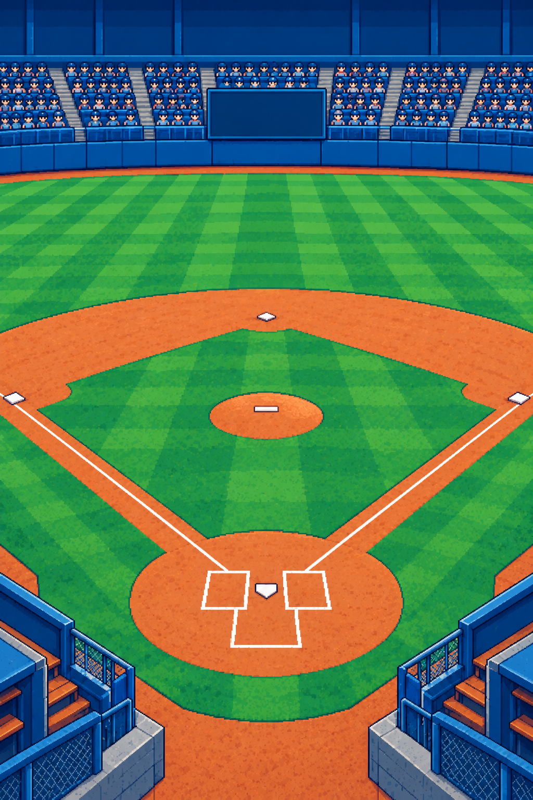

# BM · Baseball Career

**고교에서 시작하는 나만의 야구 선수 커리어**

타자와 투수, 훈련과 실전, 성장과 계약을 연결하는 iOS 도트 야구 게임입니다.

[게임 소개](#overview) · [구현 현황](#features) · [실행 방법](#getting-started) · [검증 기록](#verification) · [개발 문서](#documents)

**2026-11-25 공개 소스 인플레이 묶음:** P02~P10의 교체 일지·주자·타순/경기 이력·결과 조회, 투구 중 사건, 도루 준비와 공통 와이드 구장을 연결했습니다. 기존 타석 조작과 V15/선택 JSON·고정 보고서·경기 재개·결과/XP 1회 반영을 유지합니다. 공개할 소스만 별도 추출한 후보에서 관련 네이티브 **119개**, 일반 BM 무서명 Release 시뮬레이터 빌드, Git 보안 회귀 **10개**를 확인했습니다. 구장별90개 매핑은 다음 묶음이며 실기기·iOS17·전체 VoiceOver·장시간 인수는 별도입니다. [변경·검증 범위](docs/implementation-history.md#inplay-public-2026-11-25)

**2026-11-25 P09~P10 최초 인수:** 기존 수비·송구·주력의 공 보유/재송구, 경계 판정·진루와 공통 와이드 구장을 연결했습니다. 실제 구현·인수 범위 (로컬 자료: `docs/player-inplay-p09-p10-20261125.md`)와 실제 캡처 (로컬 자료: `../design_V240/native/index.html`)를 기록했습니다. 최종 PNG의 전광판 미래 이닝 노출까지 보정한 뒤 네이티브77개·고유UI5개·Release 시뮬레이터 빌드와 마지막 실제 캡처 확인을 마쳤습니다. 전체90개 구장별 매핑은 다음 변경에서 이어지며, 실기기 인수는 별도입니다. 이 문단의 수치는 최초 로컬 인수 기준이며, 공개 후보의 새 검증은 위에서 구분합니다. 배포·실기기 설치는 진행하지 않았습니다.

**2026-11-25 P08 로컬 추가:** 새 경기의 내 선수 1루 도루 예약(5초 준비), 코치 견제·귀루와 협살을 기존 인플레이에 연결했습니다. 실제 적용·회귀 및 미검증 (로컬 자료: `docs/player-inplay-p08-20261124.md`)을 별도로 기록했으며 기존 저장·고정 보고서·결과 1회 반영을 유지합니다. 이 문단은 최초 로컬 인수의 기록이며 공개 후보 검증은 위에서 구분합니다.

**2026-11-19 정리 기준:** 선수 모드의 핵심 기능은 구현되어 있으며, 같은 최신 후보에서의 전체 플레이·실기기·출시 인수는 진행 중입니다. 아래 검증 표는 기능과 빌드별 실제 실행 범위를 구분합니다.



구장 배경 리소스입니다. 선수·공·전광판은 경기 중 별도 레이어로 표시합니다.

<a id="overview"></a>
## 어떤 게임인가요?

16세 고교 선수로 시작해 직접 경기를 뛰고, 훈련과 경기 성적으로 성장하는 개인 커리어 게임입니다. 스카우트 관찰과 평가를 거쳐 국내·해외 진로와 계약으로 이어집니다.

**선수 생성 → 훈련·휴식 → 공식 경기 → 성장·기록 → 다음 일정**

| 항목 | 현재 기준 |
|---|---|
| 플랫폼 | iPhone · 세로 화면 · iOS 17 이상 |
| 조작 | 타자 스와이프 조준·탭 타격 / 투수 구종·코스 선택·릴리스 게이지 |
| 표현 | SwiftUI 정보 화면 + SpriteKit 도트 경기 연출 |
| 저장 | SwiftData 로컬 저장 · 서버·로그인·CloudKit 없음 |
| 개발 상태 | 기능 구현과 검증 진행 중 |

이 저장소는 iOS 네이티브 프로젝트입니다. 별도 웹 프로토타입과 전체 기획은 공개 소스 배포물에 포함하지 않습니다.

<a id="features"></a>
## 지금 플레이할 수 있는 기능

**선수 얼굴 조합 V202:** 얼굴형·눈 형태·눈매·귀를 독립 선택하고 생성 확인·홈 초상에 반영합니다. 새 선수만 기본 조합을 사용하며 기존 저장의 외형과 원장은 유지합니다. 경기 전신 모션 교체는 포함하지 않습니다.

**화면 반응 개선:** 연속 인플레이의 저전력 프레임 제한과 효과 축소를 분리하고, 계약 자격 조회·일정 전환·휴식 완료의 대기를 줄였습니다. 투구 동기 렌더링 실험과 추가 진단 코드는 로컬에 분리합니다.

**고객지원:** 사용자가 지정한 공개 문의·권리 요청 이메일 링크를 연결했습니다. 운영자·정책 시행일·문의 보관 기준과 공개 HTTPS 정책은 확정 전입니다.

이전 기능 변경과 배포 기록은 [구현·검증 이력](docs/implementation-history.md)에 보존합니다.

| 영역 | 구현한 내용 |
|---|---|
| 선수 생성·홈 | 고교 50곳 선택·무작위 배정, 타자·투수, 이름·등번호·외형·포지션·투구 손, 유형별·직접 능력치 배분. 클럽하우스에서 현재 소속팀 홈구장, 시설 바로가기와 일정·훈련·결산에 맞는 오늘 할 일을 확인 |
| 훈련·성장 | 능력별 미니게임, 구종 습득·숙련·보관, 특성·포지션 훈련, 실전 XP, 피로·휴식·하루 행동 제한 |
| 성장·역할 | 개인 발현·한정 집중·능력군별 노화, 주 위치 전환, 포지션 적합도와 코치 추천 |
| 직접 경기 | 시작 시 고정한 상대 능력·구종·구속·제구, 지켜보기·스윙·번트, 코스 선택·릴리스, 볼카운트·주자 진행 |
| 수비·주루 | 뜬공 추격, 외야 백업·베이스 커버, 병살·태그업·중계·실책, 슬라이딩·태그·베이스 포구. 안타는 타자가 도착한 루에 세이프를, 홈런은 담장 통과 연출과 득점 확정을 표시 |
| 경기·훈련 연출 | 공통 투구 시퀀스, 타격·포구·수비 연출, 효과음·심판 콜·자막·음량·접촉 진동 |
| 구단·유니폼 | 가상 KBO 10팀·NPB 15팀·MLB 15팀, 홈·원정 80벌, 구단별 옷깃·앞판·어깨·소맷단·바지·양말 |
| 구장·도감 | 고교 50개와 프로 40개(KBO 10·NPB 15·MLB 15)의 홈 구장 관중석과 잔디를 투구·타격·인플레이에서 공통으로 사용. 구단 도감에서 구장과 홈·원정 유니폼의 앞뒤를 비교. 구장 디자인 V188 (로컬 자료: `docs/design-versioning.md#history-v188`) · 홈런 연출 V189 (로컬 자료: `docs/design-versioning.md#history-v189`) · 피홈런 득점 표시 V190 (로컬 자료: `docs/design-versioning.md#history-v190`) · 특수 홈런 연출 V191 (로컬 자료: `docs/design-versioning.md#history-v191`) |
| 일정·시즌 | 팀당 연 30경기, 선발 로테이션, 비경기일 묶음 진행, 순위·누적 성적·결산·오프시즌. KBO·NPB·MLB FA 선언 가능 첫날에 멈추고 계약 시장으로 연결. [정지·이어가기 규칙](docs/implementation-history.md#overseas-fa-calendar-and-club-review) |
| 시즌 시상 | 고교·KBO·NPB·MLB의 개인 타이틀, 올해의팀, 골든글러브를 시즌 결산과 커리어 일지에서 조회. 선정 선수의 소속팀·엠블럼, 선정 근거와 보류 사유 표시. [개인 타이틀](docs/implementation-history.md#season-title-awards) · [포지션별 시상](docs/implementation-history.md#team-of-year-and-gold-glove) |
| 기록·이어하기 | 경기 원장, 양 팀 선수별 기록, 중단 후 이어하기, 결과·XP 1회 반영, 최근 5경기·시즌 성적 |
| 투구 중 사건 | 새 경기의 일반 파울/파울 번트·사구 보장 진루·낫아웃 자격과1루 승부·폭투/포일, 실제 선수/책임투수 기록. 확정 뒤 같은 시점의 포구 비교와 읽기 전용 다시 보기. 적용·검증 범위 (로컬 자료: `docs/player-inplay-p05-p07-20261124.md`) |
| 경기 조회 | 완료/지난 경기의 공통 개인 성적표·능력별 XP 비중, 같은 경기 정보 시트의 타순/이력 전환. 교체 일지·베이스 주자 정보·양 팀 타순표. 경기 중·완료·지난 경기의 이닝별 양 팀 타석과 교체, 당시 점수·아웃·주자 변화를 읽기 전용으로 조회. 옛 미기록은 추정하지 않음 |
| 관찰·프로젝트 | 28일 고정 보고서, 이전 관찰 대비 변화, 목표 구단·모집 역할·부족 조건, 훈련·공식 출전 과제 |
| 경기 준비·출전 경쟁 | 상대 분석과 경기 전 계획, 수행 근거의 다음 보고서 연결, 주전·벤치·순번 휴식과 재평가 안내 |
| 국내 진로·계약 | 고교·대학·국내 육성·1군 경로, 선발·제의·수락/거절·소속 발효, 11월 재계약, 방출·무소속 재입단 |
| 해외 진로·계약 | MLB 조직 육성·NPB 전력·MLB 메이저, 자격·경력·권리, 제의·다음 시즌 전환·승격·재계약·방출·단축 시즌 FA |
| 평가·계약 시장 | 자동·직접 조작 평가전과 역할 진단, 잔류·외부 제의 비교, 마감·제의 없음·재도전 창구. KBO 1군 시즌 성적 기반 재계약·방출, KBO·NPB·MLB 계약서의 발효 시즌 연봉 상위 비율. [잔류·방출과 연봉 순위](docs/implementation-history.md#overseas-fa-calendar-and-club-review) · [계약서](docs/implementation-history.md#transfer-contract-document) |

**V162의 새 프로 편성은 국내 10팀·일본 15팀·미국 15팀입니다.** 국내 육성도 같은 10개 구단을 사용하고 대학·미국 조직 육성은 6팀을 유지합니다. 기존 저장의 진행 중 시즌과 확정 기록은 당시 편성을 보존하며, 국내 확장은 날짜 진행에서 정한 다음 미개막 시즌부터 적용합니다. 새 커리어의 발효·동서부·경기 수·계약 시장은 편성 규칙 정본 (로컬 자료: `docs/pro-league-v162.md`)에 모았습니다.

해외 계약·FA·30경기 시즌은 가상 구단을 사용하는 게임 정책입니다. 지원·승인·게임 경력을 실제 국제계약·포스팅·FA 자격 인증으로 취급하지 않습니다.

### 아직 남아 있는 범위

**V205 인플레이 통합:** 새 공식 경기의 고정 타순·경기별 예비 주자·코치 자동 대주자와 선수 ID/책임투수 타석 원장을 연결했습니다. 기획 시안과 실제 앱의 대응·회귀 결과·미연결 규칙은 [V205 네이티브 기록](docs/native-inplay-v205.md)에 구분했습니다. 최초 로컬 구현 근거이며 이번 공개 후보 검증과 구분합니다.

- **계약 확장** · 협상, 전체 리그 시장 수급, 실제 서비스 일수·FA 재취득·보상 예외, 세부 등록·권리 정책, 직접 조작 인증 경기.
- **야구 규칙 확장** · 공식 팀 자책점, 사용자 불펜·마무리 커리어와 추가 투수 교체, 복합 수비 상황, WAR·미수집 코스별 성적. 개인 자책점·ERA와 투수 승패 기록은 구현돼 있습니다.
- **제품 인수** · 다른 기종·iOS 17 실기기, 최종 60Hz 장시간·저전력 재전환·배터리 소모, 전체 VoiceOver 직접 조작, 장기 밸런스·플레이 감각.
- **출시 대조** · V165 배포·실제 설치·기존 기록 조회 근거는 보존돼 있습니다. 이후 코드가 반영된 최종 후보의 설치 대조·새 경기·최종 수동 인수는 남아 있습니다.

<a id="getting-started"></a>
## 실행하기

### 1. 프로젝트 열기

```sh
git clone https://github.com/Beomballa/Baseball_rasing.git
cd Baseball_rasing
open BM.xcodeproj
```

Xcode에서 공유 **BM** 스킴과 iPhone Simulator를 선택해 실행합니다. Swift 6 언어 모드, 최소 배포 타깃 iOS 17.0을 사용합니다. 최소 배포 타깃은 해당 OS에서의 검증 완료를 뜻하지 않습니다.

### 2. 실기기에서 실행하기

`Signing & Capabilities`에서 자신의 Team과 고유 Bundle Identifier를 설정합니다. 서명·프로비저닝·개인 Xcode 설정은 공유 소스에 포함하지 않습니다.

기존 선수가 있는 기기에서는 별도 QA 앱·저장 공간을 사용합니다. QA를 위해 기존 앱을 삭제하거나 사용자 저장을 초기화하지 않습니다.

### 일반 앱과 QA 앱 구분

| 실행 스킴 | 아이콘 | 앱 이름 | 용도 |
|---|---|---|---|
| BM · Debug/Release | 낮 구장의 타자 스윙 | 픽셀야구인생 | 일반 플레이 |
| BM-QA · QA | 노을 구장의 투수·금색 QA | BM 성능 QA | 별도 저장에서 검증 |

두 앱은 기존 Bundle ID로 함께 설치할 수 있습니다. QA에는 **BM-QA** 스킴을 사용합니다. Bundle ID만 바꾸면 QA 아이콘 구성이 적용되지 않습니다. 임시 저장·자동 진행 인수는 기존 QA 정책을 따릅니다.

### 3. 기본 플레이 흐름

1. 선수를 생성하고 능력치·구종·일정을 확인합니다.
2. 오늘의 훈련 또는 휴식을 선택합니다.
3. 경기일에는 오늘 경기를 시작하거나 이어서 진행합니다.
4. 경기 종료·결과 저장 후 홈에서 다음 날로 넘어갑니다.

미완료 경기는 날짜 진행을 잠급니다. 자유 연습은 실제 성장·기록·날짜·피로에 반영하지 않습니다.

## 기술과 코드 구조

| 기술 | 역할 |
|---|---|
| SwiftUI | 선수 생성·홈·훈련·계약·기록 화면, 경기 조작부 |
| SpriteKit | 투구·타격·수비·주루와 도트 선수·공·경기장 렌더링 |
| SwiftData | 선수·일정·경기·훈련·관찰·계약 저장과 마이그레이션 |
| XCTest / XCUITest | 규칙·저장·중복 반영 방지·화면 흐름 검증 |

```text
BM/
├── App/           앱 시작 · 저장소 연결 · 화면 진입
├── Domain/        선수 · 경기 · 훈련 · 일정 · 계약 규칙
├── Persistence/   SwiftData 모델 · 저장 명령 · 마이그레이션
├── Features/
│   ├── Creation/  선수 생성
│   ├── Home/      선수 홈 · 커리어 정보
│   ├── Match/     경기 조작 · 인플레이 · 결과 연출
│   └── Training/  능력 · 구종 · 특성 · 포지션 훈련
├── UI/            공통 도트 UI · 패널 · 버튼
└── Resources/     학교 데이터 · 검수한 게임 아트
BMTests/           단위 · 저장 회귀 테스트
BMUITests/         화면 흐름 테스트
scripts/           Git 개인정보 검사 · 검증 보조 도구
```

### 저장할 때 지키는 원칙

- **SwiftData V15** — 기존 선수 ID·구종·원장을 이전하고 은퇴 선수를 보존합니다. 활성 선수는 역할별 1명으로 제한하며, 파일 이전 전에 DB 구성 파일을 별도 백업합니다.
- **명시 저장·실패 복구** — 자동 저장을 끄고 사건 단위로 저장합니다. 실패 시 오류·재시도를 제공하며 저장소를 자동 삭제하거나 임시 저장으로 전환하지 않습니다.
- **이어하기·1회 반영** — 경기·훈련의 진행 원장과 보상을 보존합니다. 다시 보기와 렌더링에서 새 판정·보상을 만들지 않습니다.
- **고정 근거** — 날짜·나이·피로·하루 행동, 28일 보고서·평가 창을 각 원장 규칙으로 관리합니다. 과거 미수집 기록을 추정해 채우지 않습니다.

<a id="verification"></a>
## 검증 상태

규칙·저장은 XCTest, 화면 연결은 XCUITest, 실제 기기의 성능·청취·조작감은 별도 인수로 확인합니다. 실행별 결과와 초기 실패는 [구현·검증 이력](docs/implementation-history.md#closeout-2026-11-19)에 구분합니다.

| 검증 | 실제 확인한 범위 | 남은 범위 |
|---|---|---|
| 백업·복원 V201 | 실패 원인·현재 저장 상태·재시도, 별도 iPhone QA의 실제 Files 왕복·확정 복원 | 외부 파일 제공자·실제 공간 부족·전체 VoiceOver |
| 174 대비 175 성능 | 같은 기기의 저전력 양 역할 표시 p95 33.34→16.67ms, 계약·일정·휴식 응답 개선 | 단기 비교 결과이며 전 기기·장시간 FPS 보장이 아님 |
| Release 176 장시간 | 실제 176 실행 코드의 별도 앱에서 투수 1,803.45초·타자 1,801.90초 저전력 UI 진행, 복귀 16·15회, 원장·XP 비중복 | 렌더 요청 간격과 실제 표시 FPS를 구분. 배터리 소모·표면 온도 미판정 |
| V202 얼굴 조합 | 기존 V202의 단위·저장과 양 역할 생성·재실행·큰 글자 시뮬레이터 UI 선택 검사 | 실기기·전체 VoiceOver·전체 조합 시각 인수 |
| 결과·기록 V218 | 네이티브 회귀50개·양 역할 UI 고유2개, 실제 고정 탭의 작은 화면/큰 글자 호스팅 재확인. 적용·범위 (로컬 자료: `docs/player-inplay-p04-results-records-20261124.md`) | 실기기·iOS17·전체 접근성·장시간·전체 구형 UI. 같은 경기 시트의 탭/이닝/펼침은 메모리에만 유지 |
| 이번 공개 커밋 후보 | 단위·저장 19개, UI 5개, 보안 10개 및 일반 무서명 Release 빌드 통과 | 새 전용 iPhone 17 시뮬레이터. 최신 외형의 실기기·전체 플레이 인수는 별도 |
| 최소 지원 환경·배포 | 기존 165 TestFlight 설치와 176 개발 서명 설치 기록 보존 | iOS 17 환경 대기, 최신 통합 후보의 TestFlight·수동 인수 |

176의 원본 두 커리어·9개 파일·19개 논리 테이블은 장시간 QA 전후 동일했습니다. 이 기록은 당시 176의 근거이며 이후 외형 변경까지 실기기로 검증한 결과로 확대하지 않습니다. 기능별 검사 수와 재시도를 전체 고유 테스트 수로 합산하지 않습니다.

<details>
<summary>테스트 실행 명령</summary>

사용자 저장과 분리한 전용 QA 시뮬레이터 ID를 지정합니다.

```sh
xcodebuild \
  -project BM.xcodeproj \
  -scheme BM \
  -destination 'platform=iOS Simulator,id=<QA_SIMULATOR_UDID>' \
  -derivedDataPath /tmp/BM-QA-DerivedData \
  test
```

```sh
python3 -m unittest discover -s scripts -p 'test_*.py'
```

위 명령은 실행 예시입니다. 위 표는 기능별 선택 실행 결과이며 전체 테스트 명령의 총개수가 아닙니다.

</details>

### QA 기록 보관

원시 로그·캡처·기기 식별 정보·QA 저장은 로컬 전용입니다. 실행별 `qa/versions/YYYY-MM-DD/<정책-버전>/runs/NN-purpose/`에 `run.json`, `reports/`, `captures/`, `notes/`를 보관합니다.

재실행은 새 run에 기록해 초기 실패·중단을 보존합니다. 버전 미확정 자료는 추정해 분류하지 않고 `legacy/`에 둡니다. 로컬 색인은 `qa/README.md`입니다.

<a id="documents"></a>
## 문서와 작업 규칙

| 문서 | 읽는 목적 | 배포 범위 |
|---|---|---|
| 이 README | 현재 기능·실행·저장·검증 경계 | 공개 소스 |
| 선수 모드 완료 계획 (로컬 자료: `docs/player-mode/README.md`) | 기능33·작업20·검증38·감독 착수 조건과 엑셀 | 로컬 프로젝트 |
| [개발 기준](AGENTS.md) | 판정·저장·접근성·QA·작업 규칙 | 공개 소스 |
| [구현·검증 이력](docs/implementation-history.md) | 날짜·버전·정책별 변경 이유와 당시 검증·실패 이력 | 공개 소스 |
| 프로 리그 편성과 시즌 규칙 V162 (로컬 자료: `docs/pro-league-v162.md`) | 10/15/15 편성·팀 ID·홈원정·계약 시장·기존 저장 발효·인수 기준 | 로컬 프로젝트 |
| 전체 문서 안내 (로컬 자료: `../README.md`) | 기획·QA·수정 계획·디자인 문서 진입 | 로컬 프로젝트 |
| 공통 디자인 (로컬 자료: `../design/README.md`) · 화면 기록 (로컬 자료: `docs/design-versioning.md`) | 디자인 정본·버전과 실제 캡처 | 로컬 전용 |
| `pitching-prototype/docs/` | 별도 웹 프로젝트의 전체 기획 정본 | 이 저장소 외부 |

과거의 `최근 반영` 안내와 검증 요약은 [상세 이력](docs/implementation-history.md)에 통합했습니다. 구현 이력의 과거 미구현·미실행 문구는 해당 시점의 상태입니다.

공유 소스·테스트·검수된 게임 아트·명시 허용한 문서만 Git에서 관리합니다. 세이브·서명 키·토큰·개인 설정·진단 자료는 제외합니다. 학교 정보·참고 리소스의 포함은 공식 자산 이용 허락을 뜻하지 않습니다.

커밋·push는 현재 사용자 요청과 작업 규칙에 따라 변경 범위·검증·민감정보·원격 상태를 확인한 뒤 진행합니다. 문서 정리만으로 자동 실행하지 않습니다. 커밋 메시지 형식은 `YYYY.MM.DD 구체적인 기능 작업 수행`입니다.
